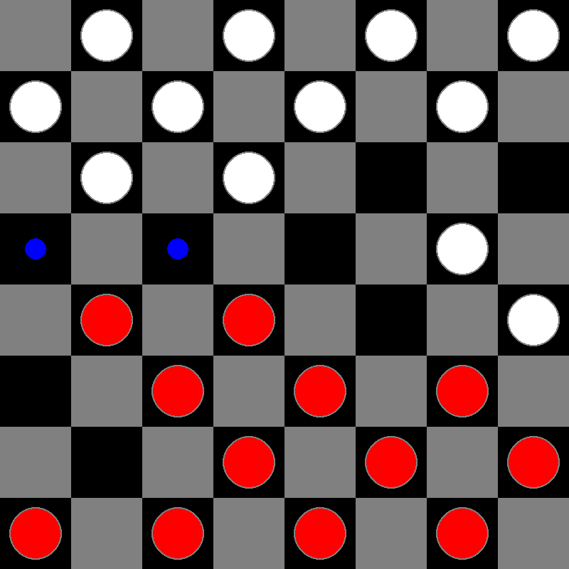

# Checkers AI with Minimax 🔴⚫

  

A fully playable Checkers game built in Python, featuring an AI opponent powered by the Minimax algorithm. 

## Description
This project implements a classic game of Checkers using the Pygame library for the graphical interface. The core feature is the AI opponent, which evaluates the board state and makes calculated decisions using a recursive Minimax algorithm. 

## Features
* **Playable Interface:** Interactive graphical board with valid-move highlighting.
* **Minimax Algorithm:** The AI simulates future moves to determine the optimal strategy against the player.
* **Adjustable Difficulty:** The search depth of the algorithm can be modified to make the AI more or less challenging.
* **Decision Visualization:** (Optional) Can be configured to visually display the AI's search process in real-time.

## Technologies Used
* Python 3
* Pygame

## How to Run the Game
1. Make sure you have Python installed on your computer.
2. Clone this repository or download the files.
3. Install the required Pygame library by running:
   `pip install pygame`
4. Run the main game file:
   `python main.py`

## How to Play
* You control the Red pieces at the bottom of the board.
* Click on a red piece to see your valid moves (highlighted in blue).
* Click a blue circle to move your piece.
* Once you complete your turn, the AI (White pieces) will automatically calculate and make its move.

## License
[MIT](LICENSE) © 2026 Alonso Ochoa
